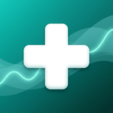



A private, easy-to-use personal and family lab tracker that turns checkup results into clear long-term trends.

**My Health Dash** is a clean, privacy-first app for tracking personal and family health checkups. With no account required and no cloud storage of your medical history, it helps you organize scattered lab reports into a clear, readable health dashboard.

## Key Features

- **Stored Privately on Your Device**: No sign-up, no ads, and no tracking. All profiles, checkup reports, and measurements stay on your device. Includes full backup & restore as well as spreadsheet export and import.
- **40+ Common Checkup Items**: Covers everyday vitals (with automatic BMI calculation), blood counts, blood sugar, cholesterol & lipids, liver and kidney function, thyroid, urinalysis, and routine screenings.
- **Smart Reference Ranges & Unit Conversion**: Automatically matches reference ranges by age and biological sex, lets you enter values in the exact units printed on your lab report, and includes plain-language guides for each item.
- **Multi-Profile Family Tracking**: Keep separate records for yourself, your partner, parents, or children in one place, and switch profiles with a single tap.
- **Clear Timeline & Trend Charts**: Log quick measurements or group them under checkup reports, view key status bars on the Home screen, and explore multi-year trend charts.
- **Optional De-Identified AI Insights**: Request on-demand AI summaries when you want extra context. Personal identifiers such as your name and exact birth date are stripped before sending, and past summaries are saved locally on your device.
- **Clean Native Experience**: Supports Light and Dark modes, English, Simplified Chinese, and Traditional Chinese across iPhone, iPad, and Android.

## Medical Disclaimer

My Health Dash is intended for personal health recordkeeping and informational reference only. Reference intervals vary by laboratory and clinical context. App indicators and AI insights do not constitute medical diagnosis, treatment, or professional medical advice. Always consult a qualified healthcare professional regarding your health or abnormal lab results.

## Download & Platforms

This app has not been released yet and is currently preparing to launch on the App Store and Google Play.

Supported Platforms: iOS (iPhone & iPad) · Android (Not Yet Released)

## Contact Us

For technical support or inquiries, please contact <tosuhe@gmail.com>.

## Legal

[Privacy Policy](privacy.en.html) · [Terms of Use & Medical Disclaimer](eula.en.html)
